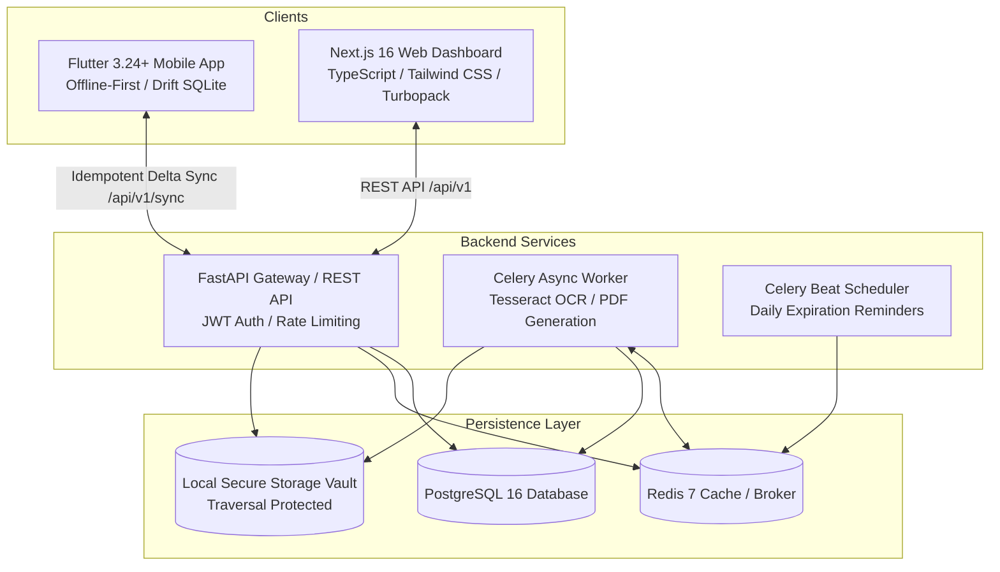

# Vaultly — Smart Receipt, Warranty & Subscription Vault

[](.github/workflows/backend.yml)
[](.github/workflows/web.yml)
[](.github/workflows/flutter.yml)
[](.github/workflows/docker.yml)

**Vaultly** is a personal asset and expense vault for tracking receipts, purchases, warranties, and subscriptions. Built with an **offline-first Flutter mobile application** as the primary client and a **Next.js 16 companion web dashboard** for analytics, bulk operations, and household debt settlement.

Engineered strictly with **100% free and open-source tooling** — zero paid third-party APIs, zero cloud vendor lock-in.

---

## Architecture Overview



---

## Key Features

- **Receipt Vault & OCR Pipeline**:
  - Tesseract OCR ingestion with automated image deskewing, contrast normalization, and heuristic text parsing.
  - Per-field confidence scoring (never fabricates or guesses missing fields).
  - 4-factor duplicate detection (Merchant + Date + Total, Invoice No, Text Hash, Image Hash).
- **Warranty Expiration Tracking**:
  - Automatic status engine (`ACTIVE`, `EXPIRING_SOON`, `EXPIRED`, `UNKNOWN`) handling leap years and month-end dates.
  - Automated Celery Beat reminders 30, 14, and 7 days before expiry.
- **Subscriptions & Run-Rate Analytics**:
  - Supports Weekly, Monthly, Quarterly, Semi-Annual, and Yearly recurring intervals.
  - Computes normalized monthly and annual burn rate.
- **Fair Household Expense Splits**:
  - Largest-remainder penny-rounding distribution guaranteeing $\sum \text{shares} \equiv \text{total}$ down to the exact cent.
  - Multi-user debt settlement and balance calculation matrix.
- **Offline-First Mobile Sync**:
  - Local Drift SQLite database for zero-latency offline operations.
  - Operation sync queue (`CREATE`, `UPDATE`, `DELETE`) with UUID idempotency keys.
  - Interactive version conflict resolution (Keep Local vs Accept Server).
- **Enterprise Security**:
  - Bcrypt password hashing, JWT access token rotation, and refresh token revocation with reuse detection.
  - Local file storage protected against path traversal attacks.

---

## Monorepo Layout

```
vaultly/
├── backend/                  # FastAPI Application
│   ├── alembic/              # Database Schema Migrations
│   ├── app/
│   │   ├── api/v1/           # Modular REST Endpoints
│   │   ├── core/             # Config, Security, Database GUID decorators
│   │   ├── models/           # SQLAlchemy 2.x Domain Models
│   │   ├── schemas/          # Pydantic v2 Validation Schemas
│   │   ├── services/         # OCR, Warranties, Subscriptions, Splits, Reports
│   │   ├── storage/          # LocalStorageService with MIME & Traversal checks
│   │   └── workers/          # Celery & Beat Task Queue
│   └── tests/                # Pytest Test Suite (24 tests passing)
├── mobile/                   # Flutter Mobile Client
│   ├── lib/
│   │   ├── core/             # Dio Client with Secure Token Storage
│   │   ├── data/             # Drift SQLite & Sync Queue Manager
│   │   └── features/         # Auth, Receipts, OCR Review, Warranties, Sync
│   └── test/                 # Unit Tests for Offline Sync Queue
├── web/                      # Next.js 16 Web Dashboard
│   ├── app/                  # App Router Pages (Receipts, Warranties, Splits)
│   ├── components/           # Responsive Sidebar & Modals
│   └── lib/api.ts            # Typed Client with Auth State Management
├── infrastructure/           # PowerShell CLI & Docker Infrastructure
├── docs/                     # Phases, System Architecture, Interview Guide
├── docker-compose.yml        # Development Stack (Postgres, Redis, Backend, Worker, Beat, Web)
└── docker-compose.prod.yml   # Production Hardened Override
```

---

## Quick Start (PowerShell CLI)

Use the built-in PowerShell automation CLI in `infrastructure/scripts/vaultly.ps1`:

### 1. Initial Setup & Seed
```powershell
# Copy environment template
Copy-Item .env.example .env

# Run database migrations
.\infrastructure\scripts\vaultly.ps1 migrate

# Seed demo account and test vault data
.\infrastructure\scripts\vaultly.ps1 seed
```

### 2. Demo Credentials
| Role | Email | Password |
| :--- | :--- | :--- |
| **Primary Demo** | `demo@vaultly.app` | `Password123!` |

### 3. Run Development Stack
```powershell
# Run the Docker Compose stack (Postgres, Redis, API, Celery Worker, Beat, Next.js Web)
.\infrastructure\scripts\vaultly.ps1 dev
```

- **Web Dashboard**: [http://localhost:3000](http://localhost:3000)
- **FastAPI Documentation**: [http://localhost:8000/docs](http://localhost:8000/docs)
- **Health Check Probe**: [http://localhost:8000/health](http://localhost:8000/health)

---

## Verification & Testing

Run all unit tests and static linters locally:

```powershell
# Run Pytest test suite (backend)
.\infrastructure\scripts\vaultly.ps1 test

# Run Ruff linter and Next.js / ESLint checks
.\infrastructure\scripts\vaultly.ps1 lint
```

### Test Suite Summary
- **Backend Tests**: 24 tests passing (100% pass rate in ~10s).
- **Backend Linting**: 82 files clean, 0 Ruff errors.
- **Web App**: Production build verified (`next build` 12 static routes, 0 errors).
- **Web Linting**: ESLint clean, 0 errors.

---

## Production Deployment

Deploy the hardened multi-container stack with restart policies, volume mounts, and isolated networks:

```powershell
docker compose -f docker-compose.yml -f docker-compose.prod.yml up --build -d
```

---

## Deep Dive Documentation

For system design explanations, offline conflict algorithms, and interview question solutions, refer to:
- [Interview & Architecture Guide](docs/interview-guide.md)
- [Complete Phase Roadmap](docs/phases.md)
- [Truthful Build Progress](docs/build-progress.md)
