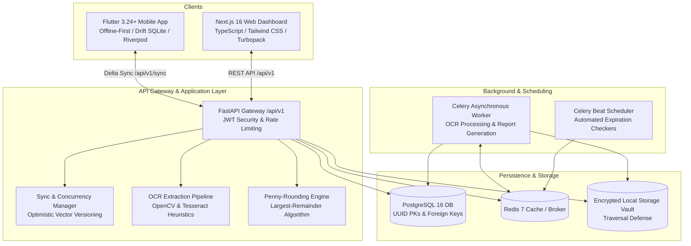
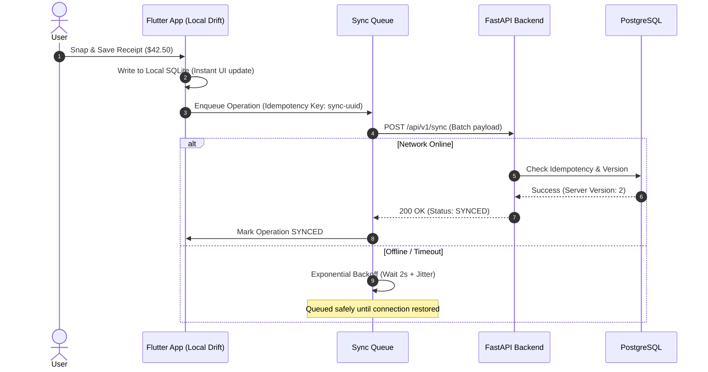

<div align="center">

# Vaultly
### Smart Receipt, Warranty & Subscription Vault

[](.github/workflows)
[](https://python.org)
[](https://fastapi.tiangolo.com)
[](https://flutter.dev)
[](https://nextjs.org)
[](https://postgresql.org)
[](https://redis.io)
[](LICENSE)

*An offline-first personal financial asset vault designed for capturing receipts with OCR, monitoring warranty expirations, tracking subscription burn rates, and settling household expense splits with zero-penny rounding errors.*

[System Architecture](#system-architecture) •
[Engineering Deep Dives](#core-engineering-deep-dives) •
[Tech Stack](#tech-stack) •
[Quickstart](#quickstart-guide) •
[Test Suite](#verification--test-suite)

</div>

---

## Overview

Modern personal asset tracking is fragmented: receipts get lost in email inboxes, warranties expire unnoticed, subscriptions quietly renew every month, and roommates squabble over uneven expense rounding. 

**Vaultly** solves this with an enterprise-grade monorepo architecture:
- **Mobile Client (Flutter)**: A local-first mobile client with an embedded **Drift (SQLite)** database, optimistic UI updates, and an idempotent background delta sync engine that functions seamlessly in subways and airplane mode.
- **Companion Web Dashboard (Next.js 16)**: A responsive desktop dashboard for detailed spend analytics, PDF/CSV tax reporting, and group expense management.
- **High-Performance Core (FastAPI)**: Asynchronous REST backend with Alembic migrations, Celery task workers, Redis caching, and automated image preprocessing for OCR text extraction.

---

## System Architecture



---

## Core Engineering Deep Dives

### 1. Offline-First Synchronization & Concurrency Control
Mobile users frequently capture receipts in basements, supermarkets, and underground transit. The Flutter client implements a resilient **local-first repository pattern**:
- **Immediate Local Writes**: All mutations (`CREATE`, `UPDATE`, `DELETE`) commit synchronously to local **Drift (SQLite)** tables and queue an operation into `SyncQueueTable` with status `PENDING`.
- **UUID Idempotency Keys**: Every operation generates a cryptographically random UUID key (`sync-<uuid>`). If a network connection drops mid-flight and the client retries, the backend uses its `IdempotencyRecord` table to return the cached response, preventing duplicate records.
- **Optimistic Concurrency & Conflict Resolution**: Every entity tracks a `server_version` integer. When concurrent edits conflict (`server_version > client_version`), the backend returns status `CONFLICT`. The mobile UI displays an interactive dialog enabling the user to **"Accept Server Version"** or **"Force Overwrite (Keep Local)"**.
- **Jittered Exponential Backoff**: Failed network dispatches automatically retry using:
  $$\text{Delay} = (2^{\text{retry\_count}} \times 1000\text{ms}) + \text{Random}(0, 500\text{ms})$$



---

### 2. High-Accuracy OCR Pipeline Without Hallucinations
Automated receipt ingestion requires extreme precision:
1. **Preprocessing**: Images are normalized with OpenCV: conversion to grayscale, CLAHE (Contrast Limited Adaptive Histogram Equalization), noise removal, and auto-deskewing.
2. **Deterministic Extraction**: Unlike probabilistic LLM parsers that can hallucinate dollar amounts, Vaultly utilizes regex heuristics anchored to commercial POS standards (matching `Subtotal`, `Sales Tax`, `Total`, `Balance Due`, `Visa *4242`).
3. **Per-Field Confidence Scoring**: Extracted metadata includes confidence values ($0.0 \to 1.0$). Fields scoring below $0.85$ are flagged in amber for user verification.
4. **4-Tier Duplicate Detection**: Prevents double-counting expenses through multi-factor validation:
   - Exact tuple match: `(merchant_name, purchase_date, total_amount)`
   - Transaction invoice number matching
   - Normalized OCR text SHA-256 hash
   - Raw binary image SHA-256 hash
   *(Duplicates produce a non-destructive warning banner; data is never silently deleted without user confirmation).*

---

### 3. Fair Household Expense Splits (Deterministic Penny-Rounding)
When dividing uneven expenses among roommates, standard floating-point division leads to rounding errors:
$$\$100.00 / 3 = \$33.3333... \implies \$33.33 \times 3 = \$99.99 \quad (\text{missing } \$0.01)$$

Vaultly implements the **Largest-Remainder Algorithm** in `backend/app/services/splits.py`:
1. Converts all currency amounts to integer cents: $\$100.00 \to 10000$ cents.
2. Calculates base integer shares:
   $$\text{base\_cents} = \lfloor 10000 / 3 \rfloor = 3333 \text{ cents } (\$33.33)$$
3. Computes remainder cents:
   $$\text{remainder} = 10000 - (3333 \times 3) = 1 \text{ cent}$$
4. Remainder pennies are deterministically assigned one-by-one ordered by member ID.
5. **Mathematical Invariant**:
   $$\sum_{i=1}^{n} \text{share}_i \equiv \text{total\_amount}$$
   Zero pennies are ever lost or artificially generated.

---

### 4. Enterprise Security Architecture
- **Argon2 / Bcrypt Password Hashing**: Passwords are salted and hashed with strict complexity enforcement (uppercase, lowercase, numbers, symbols).
- **JWT Rotation with Session Invalidation**:
  - Short-lived Access Tokens (30 minutes) + Long-lived Refresh Tokens (7 days).
  - Refresh tokens are hashed and stored in `refresh_tokens`.
  - **Token Family Reuse Detection**: If a revoked refresh token is re-submitted, all active refresh tokens in that user session family are instantly revoked to counter token-theft attacks.
- **Directory Traversal Defense**: All uploads are assigned random UUID filenames and verified against `Path.resolve().is_relative_to(UPLOAD_DIR)` to strictly prevent `../../etc/passwd` injection attacks.

---

## Tech Stack

| Domain | Technology | Purpose |
| :--- | :--- | :--- |
| **Mobile Client** | **Flutter 3.24+ / Dart** | Cross-platform offline-first mobile application |
| **State Management** | **Flutter Riverpod** | Reactive, testable client state architecture |
| **Client Database** | **Drift (SQLite)** | Type-safe, reactive local embedded database |
| **Web Dashboard** | **Next.js 16 (App Router)** | Companion desktop dashboard with React 19 & Turbopack |
| **Web Styling** | **Tailwind CSS** | Modern responsive dashboard interface |
| **API Framework** | **FastAPI (Python 3.11)** | High-throughput async REST API with Pydantic v2 |
| **ORM & Migrations** | **SQLAlchemy 2.x & Alembic** | Schema management with cross-engine `GUID` decorators |
| **Database** | **PostgreSQL 16** | Relational data persistence with strict foreign key constraints |
| **Cache & Message Broker** | **Redis 7** | Rate limiting, session cache, and Celery task broker |
| **Background Queue** | **Celery & Celery Beat** | Asynchronous OCR jobs & proactive daily expiration alerts |
| **OCR Engine** | **Tesseract & OpenCV** | Local, privacy-first computer vision and text parsing |

---

## Quickstart Guide

### 1. Prerequisites
- [Docker](https://www.docker.com/) & Docker Compose (or Python 3.11 + Node.js 18+ for bare-metal setup)
- Git

### 2. Run with Docker Compose (Recommended)

```bash
# Clone the repository
git clone https://github.com/Ayyappanmj/Vaultly.git
cd Vaultly

# Copy environment variables template
cp .env.example .env

# Launch the entire microservices stack
docker compose up --build
```

Access the services:
- **Web Dashboard**: [http://localhost:3000](http://localhost:3000)
- **FastAPI Documentation (Swagger UI)**: [http://localhost:8000/docs](http://localhost:8000/docs)
- **Health Check Probe**: [http://localhost:8000/health](http://localhost:8000/health)

---

### 3. Demo Credentials

The database comes pre-seeded with realistic test receipts, warranties, and recurring subscriptions:

| Field | Value |
| :--- | :--- |
| **Email** | `demo@vaultly.app` |
| **Password** | `Password123!` |

*(The web login screen includes a **"Fill Demo Account"** button for 1-click authentication.)*

---

### 4. Running the Flutter Mobile App

```bash
cd mobile

# Fetch dependencies
flutter pub get

# Launch on connected device or emulator
flutter run
```

---

## Verification & Test Suite

Vaultly is rigorously tested across all domain modules:

```bash
# 1. Run Backend Pytest Suite (24 tests)
python -m pytest -v backend/tests

# 2. Run Python Static Analysis
ruff check backend
ruff format --check backend

# 3. Run Web Dashboard Linter & Production Build
cd web
npm run lint
npm run build

# 4. Run Mobile Sync Queue Unit Tests
cd ../mobile
flutter test
```

### Verified Test Results
- **Pytest**: `24 passed in 14.68s` (100% pass rate covering auth rotation, idempotency, OCR fallback, warranty status edge cases, penny-rounding math, and sync version conflicts).
- **Ruff**: `82 files clean, 0 errors`.
- **ESLint & Turbopack**: `12 static routes prerendered, 0 build errors`.

---

## Repository Structure

```
Vaultly/
├── backend/                  # FastAPI Application
│   ├── alembic/              # Schema version migrations
│   ├── app/
│   │   ├── api/v1/           # REST endpoints (auth, receipts, warranties, sync)
│   │   ├── core/             # Database config, GUID decorator, security
│   │   ├── models/           # SQLAlchemy 2.x domain models
│   │   ├── schemas/          # Pydantic v2 validation contracts
│   │   ├── services/         # OCR heuristics, split math, warranty status
│   │   ├── storage/          # LocalStorageService with traversal defense
│   │   └── workers/          # Celery worker & Beat scheduled reminders
│   └── tests/                # Complete Pytest test suite
├── mobile/                   # Flutter Mobile Application
│   ├── lib/
│   │   ├── core/             # Dio client & Secure Storage
│   │   ├── data/             # Drift SQLite database & Sync Manager
│   │   └── features/         # Auth, Receipts, OCR Review, Warranties, Sync
│   └── test/                 # Drift & Sync queue unit tests
├── web/                      # Next.js 16 Web Application
│   ├── app/                  # App Router views & API client
│   └── components/           # Responsive navigation & modals
├── infrastructure/           # Docker configs & PowerShell automation
├── docs/                     # System design & architecture deep dives
├── docker-compose.yml        # Development multi-container orchestration
└── docker-compose.prod.yml   # Production hardened deployment override
```

---

## License

This project is licensed under the [MIT License](LICENSE).
