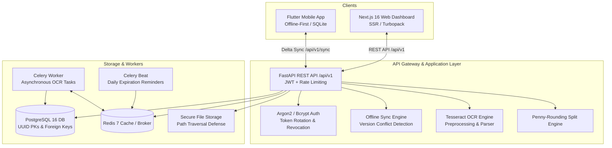

# Vaultly — System Architecture & Engineering Interview Guide

This guide details the deep architectural decisions, trade-offs, algorithms, and security guarantees designed into **Vaultly — Smart Receipt, Warranty & Subscription Vault**.

---

## 1. High-Level System Architecture

Vaultly is designed as a **production-inspired monorepo** consisting of:
- **Backend API**: Python 3.11 with FastAPI, SQLAlchemy 2.x, Alembic, PostgreSQL, Redis, and Celery + Celery Beat.
- **Mobile Client (Primary)**: Flutter with Riverpod, Drift (SQLite), and an offline-first sync engine.
- **Web Dashboard (Companion)**: Next.js 16 (App Router), TypeScript, Tailwind CSS, and Charting for bulk import, PDF/CSV export, and analytics.
- **Infrastructure**: Docker Compose with multi-stage builds and GitHub Actions CI pipelines.

---

## 2. Deep Dive: Offline-First Synchronization Engine

### The Problem
Mobile devices often experience intermittent connectivity (subways, remote stores). Users must be able to scan receipts, log purchases, and modify warranties without being blocked by network failures.

### The Solution: Idempotent Delta Sync with Version Conflict Detection
1. **Local-First Writes**:
   All user actions (`CREATE`, `UPDATE`, `DELETE`) are committed immediately to the local Drift SQLite database and simultaneously appended to `SyncQueueTable` with status `PENDING`.
2. **Idempotency Guarantee**:
   Each mutation generates a cryptographically random UUID idempotency key (`sync-<uuid>`). If network timeout occurs during transit and the client retries, the backend uses `IdempotencyRecord` to return the cached response without duplicate creation.
3. **Optimistic Concurrency & Conflict Detection**:
   Every entity (`Receipt`, `Warranty`, `Purchase`) carries a `version` integer:
   - On edit, client submits `client_version`.
   - If `server_version > client_version`, the server rejects with status `CONFLICT` and returns both payloads.
   - The client UI presents an interactive conflict modal: **"Accept Server Version"** vs. **"Force Overwrite (Keep Local)"**.
4. **Exponential Backoff with Jitter**:
   Failed operations retry using:
   $$\text{Delay} = (2^{\text{retry\_count}} \times 1000\text{ms}) + \text{Random}(0, 500\text{ms})$$
   Max retries is capped at 5 before flagging as `FAILED`.

---

## 3. Deep Dive: Receipt OCR & Confidence Scoring

### Pipeline Architecture

### 1. Robust Preprocessing
- **Image Sanitization**: Checks MIME type (`image/jpeg`, `image/png`, `image/webp`) and 15MB size ceiling.
- **Enhancement**: OpenCV converts to grayscale, applies Gaussian bilateral filtering, enhances contrast with CLAHE, and auto-rotates based on EXIF orientation.

### 2. Heuristic Parsing Without Hallucinations
- **Strict Rule**: We never invent data. Fields that cannot be extracted with high confidence remain `null` or are flagged `LOW_CONFIDENCE`.
- **Merchant Extraction**: Cleans noise headers and selects prominent top-of-receipt text.
- **Date Matching**: Regex patterns handling ISO (`YYYY-MM-DD`), US (`MM/DD/YYYY`), and European formats.
- **Amount Extraction**: Regex capturing `Total`, `Balance Due`, `Amount`, finding the maximum bottom total while properly identifying tax and subtotal.
- **Confidence Scoring**:
  - Merchant: 0.95 if matched clean merchant name.
  - Date: 0.90 if valid parsed date within the past 10 years.
  - Total: 0.98 if currency and decimal format aligns with subtotal/tax summation.

### 3. Multi-Factor Duplicate Detection
Prevents accidental double-scanning of the same receipt through a 4-tier check:
1. Exact match on `(merchant_name, purchase_date, total_amount)`.
2. Receipt invoice / transaction number match.
3. SHA-256 hash of the normalized OCR text.
4. Image file SHA-256 hash.

*Crucial rule*: Duplicates trigger a warning banner in UI; they are **never silently auto-deleted**, preserving user agency.

---

## 4. Deep Dive: Deterministic Penny-Rounding in Expense Splits

### The Floating-Point Penny Problem
In financial applications, dividing uneven amounts among multiple users leads to rounding errors:
$$\$100.00 / 3 = \$33.3333...$$
If each user pays $\$33.33$, the total is $\$99.99$, losing $\$0.01$. If rounded to $\$33.34$, total is $\$100.02$, overcharging by $\$0.02$.

### The Vaultly Solution: Largest-Remainder Distributer
Implemented in `backend/app/services/splits.py`:
1. Total amount is converted to integer cents: $\$100.00 \to 10000$ cents.
2. Base share per user:
   $$\text{base\_cents} = \lfloor 10000 / 3 \rfloor = 3333 \text{ cents } (\$33.33)$$
3. Remainder cents calculated:
   $$\text{remainder} = 10000 - (3333 \times 3) = 1 \text{ cent}$$
4. The remainder cents are deterministically distributed one cent at a time to members sorted by `user_id`.
5. **Mathematical Invariant**:
   $$\sum_{i=1}^{n} \text{share}_i \equiv \text{total\_amount}$$
   Zero pennies are ever lost or created.

---

## 5. Security & Privacy Architecture

1. **Password Security**: Direct `bcrypt` with salt and minimum 8-character requirements with uppercase, lowercase, numbers, and symbols.
2. **JWT Token Rotation & Revocation**:
   - Short-lived Access Token (15–30 minutes).
   - Long-lived Refresh Token (7 days) stored with hashed UUID in `refresh_tokens` table.
   - Upon refresh, the previous token is marked `revoked=True` and a new token pair is issued.
   - **Reuse Detection**: If a revoked refresh token is presented, all refresh tokens for that user session are immediately invalidated (anti-theft defense).
3. **Path Traversal Defense**:
   - Uploaded files are stripped of original dangerous filenames and assigned cryptographic UUIDs.
   - File paths are validated against `Path.resolve().is_relative_to(UPLOAD_DIR)` to strictly prevent `../../etc/passwd` directory traversal attacks.
4. **Data Isolation**:
   - Every database query enforces `WHERE user_id = current_user.id` or household membership checks.
   - Private receipts are only downloadable through authenticated endpoints (`/api/v1/receipts/{id}/images/{img_id}`).
