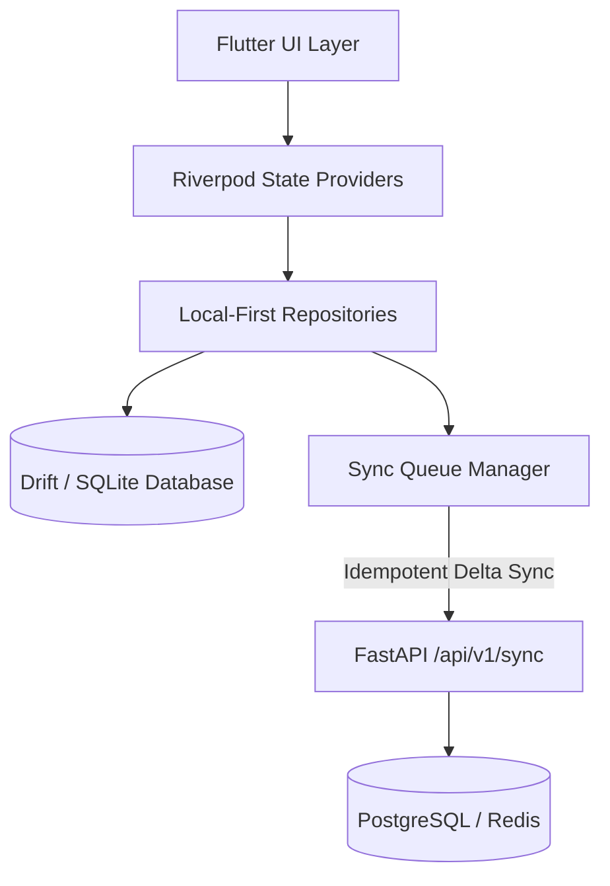

# Vaultly Mobile (Flutter Offline-First App)

Vaultly's primary client application is built with **Flutter**, featuring an **offline-first local database architecture** powered by Drift (SQLite) and a robust background synchronization engine with optimistic UI updates.

---

## Architecture Overview



### Key Components

- **Drift SQLite Layer** (`lib/data/database/database.dart`):
  Mirrors backend entities (`LocalReceipts`, `LocalWarranties`, `LocalSubscriptions`, `SyncQueueTable`) for instant local-first read and write operations without network latency.
- **Sync Manager** (`lib/data/sync/sync_manager.dart`):
  Enqueues `CREATE`, `UPDATE`, and `DELETE` operations with unique UUID idempotency keys. Features:
  - Exponential backoff with random jitter.
  - Automatic retry mechanism (up to 5 attempts).
  - Version-number conflict detection.
  - Interactive manual conflict resolution dialog (Keep Local vs Accept Server).
- **Interactive OCR Review Screen** (`lib/features/receipts/ocr_review_screen.dart`):
  Displays extracted fields with confidence indicators (e.g. 95% High Confidence vs Low Confidence warning), inline editing, and duplicate warnings.
- **Secure Token Storage** (`lib/core/api_client.dart`):
  Uses `flutter_secure_storage` with automated token rotation and refresh token handling.

---

## Running the Mobile App

### Prerequisites
- Flutter SDK 3.24+ installed on your host system
- Android Studio / Xcode / Chrome for target devices

### Commands

```powershell
# Inside mobile/
flutter pub get
flutter run
```

### Running Unit Tests

```powershell
flutter test
```
